## 🧠 `whoami`

Offensive security researcher focused on **command-and-control tradecraft**, **Active Directory attack paths**, and **EDR evasion**. I build and dissect adversary emulation tooling in a controlled red team lab — never in production — and document findings so the work outlives the session.

## 🛠️ Arsenal

**C2 & Post-Exploitation**

**Active Directory & Internal**

**Recon & Web**

## 🎯 Proof

- **[JIRA2Shell](https://github.com/semtexbughunt/JIRA2Shell)** — Reverse shell via a JIRA application server.

Connect
-------
[semtex@mailfence.com](mailto:semtex@mailfence.com) · [semtexbughunt](https://github.com/semtexbughunt)

semtexbughunt · red team lab · 2026
